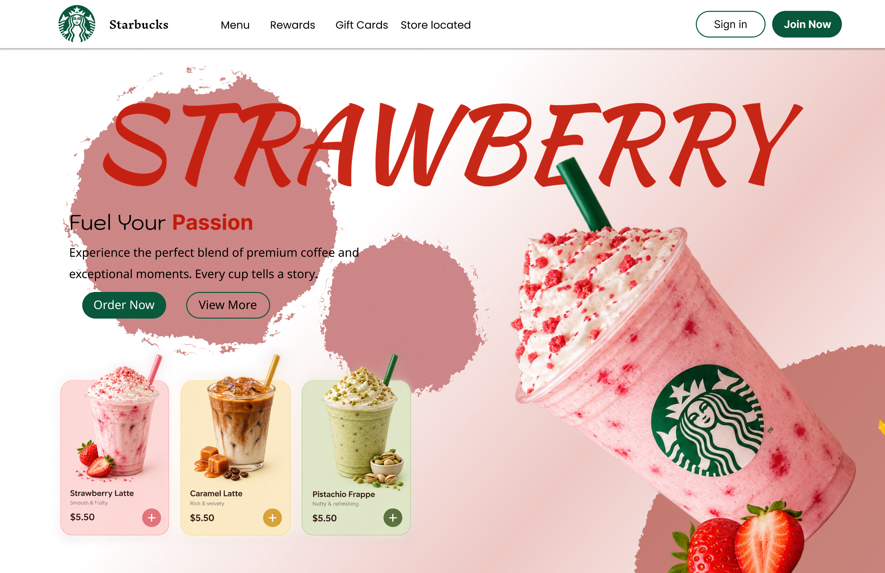
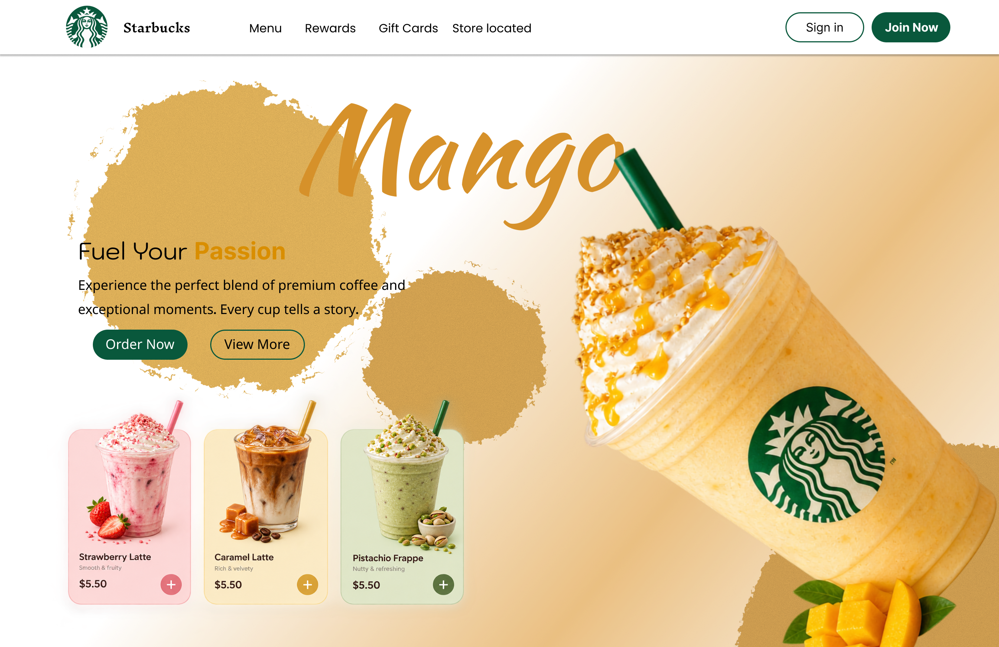
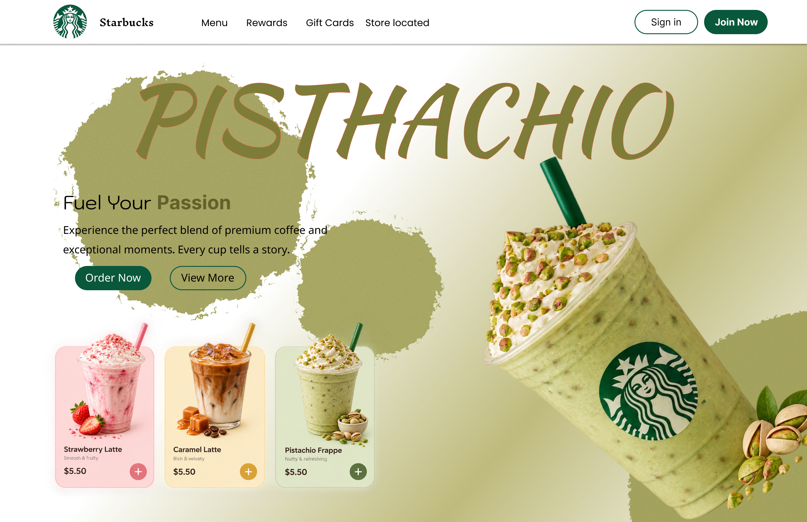

# ☕ Animated Coffee Cards

A creative coffee-themed UI project featuring three stylish coffee product cards with pastel colors and smooth animations.

## ✨ Features

- Three unique coffee product cards
- Soft pink, warm yellow, and pistachio green color palette
- Attractive coffee product visuals
- Smooth animations and interactive effects
- Clean, modern, and visually appealing layout

## 🎨 Design Highlights

The interface combines pastel colors, product-focused layouts, and animated elements to create an engaging coffee menu experience.

## 🛠️ Tools Used

- Figma
- UI Design
- Prototype

## 🔗 Figma Prototype

Explore my interactive coffee card design and animations in Figma.

👉 [**View Interactive Prototype**](https://www.figma.com/proto/kpOrlRTNPxlSlQWkUlj4Rh/Smart-animation?node-id=2-9&p=f&viewport=556%2C579%2C0.09&t=Jiqmy8ZLFusOtsJO-1&scaling=min-zoom&content-scaling=fixed&page-id=0%3A1)

Example:

## 🎯 Project Goal

Created as part of my UI design and animation practice to improve my visual design skills and explore engaging interface concepts.

## 👩‍💻 Created By

Priya Dharshini M
